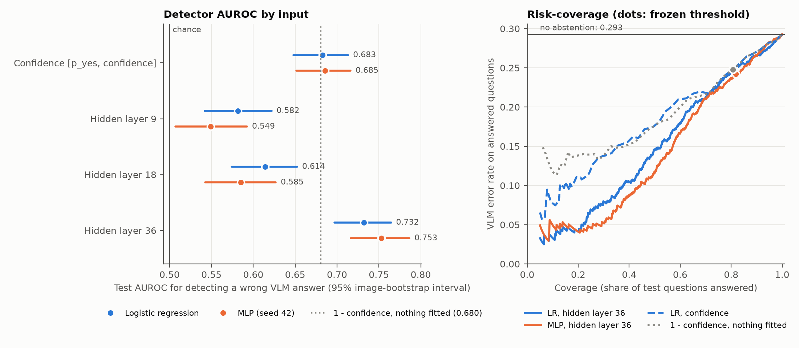
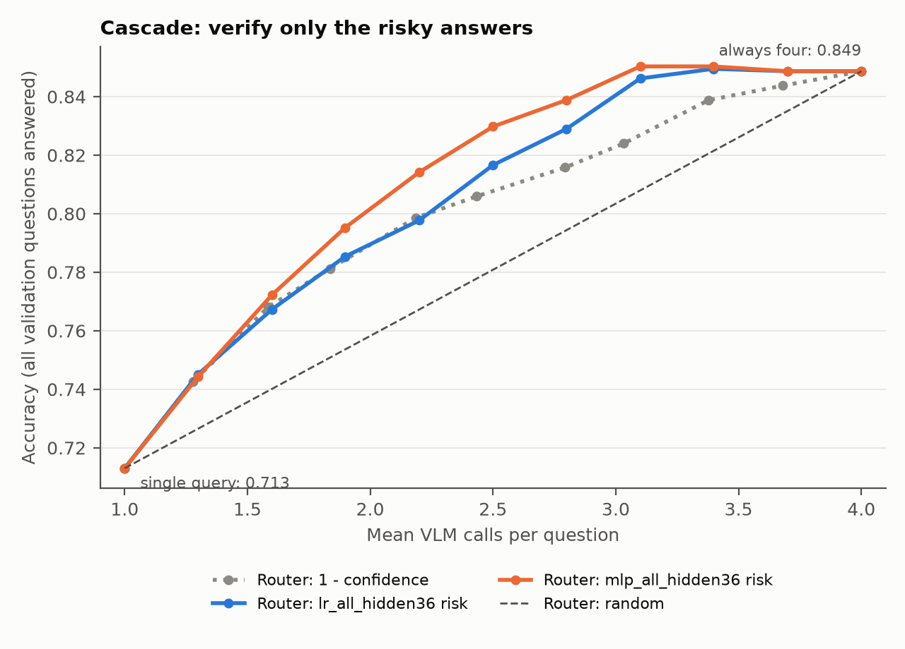

# Results: VLM spatial-relation error detection on Visual Genome

Generated by `scripts/09_report.py` from saved artifacts (`outputs/results.json`,
`outputs/detectors/frozen.json`, `outputs/test_predictions.csv`). Do not edit by hand.

## Set-up

- VLM: `Qwen/Qwen2.5-VL-3B-Instruct` (revision `66285546d2b8`), 4-bit NF4, frozen;
  same configuration as the group's VSR experiment.
- Data: Visual Genome relationships with eight canonical spatial predicates; four generated
  statements per relationship (2 true, 2 false). Split by image.
  Train 5568 queries (1345 images),
  validation 1216 (291),
  test 1216 (293).
- Target: `y_error = 1` when the VLM's Yes/No answer disagrees with the VG-derived truth.
- Train error rate 0.293, validation 0.287.
- All fitting used train only; hyperparameters and abstention thresholds used validation only.
  Test was scored once (2000 image-clustered bootstrap resamples).

## Test set

1216 queries from 293 images; 356 VLM errors.
VLM accuracy 0.707; error prevalence 0.293
(this is the chance line for error-class average precision).

## Detection results

Higher risk means the answer is more likely wrong. MLP rows are seed 42 (primary).
Brier score is descriptive only.

| Model | Selected on validation | Validation AUROC | Test AUROC | 95% interval | Test AP | Brier |
|---|---|---|---|---|---|---|
| `heuristic_confidence` | nothing fitted | 0.664 | 0.680 | [0.645, 0.712] | 0.438 | 0.192 |
| `lr_all_confidence` | C=0.001, weights=None | 0.672 | 0.683 | [0.648, 0.713] | 0.438 | 0.195 |
| `mlp_all_confidence` | decay=0.0001, weights=balanced | 0.673 | 0.685 | [0.651, 0.716] | 0.442 | 0.224 |
| `lr_all_hidden9` | C=0.001, weights=None | 0.589 | 0.582 | [0.542, 0.622] | 0.348 | 0.205 |
| `mlp_all_hidden9` | decay=0.0001, weights=balanced | 0.600 | 0.549 | [0.507, 0.592] | 0.331 | 0.259 |
| `lr_all_hidden18` | C=0.001, weights=None | 0.588 | 0.614 | [0.574, 0.652] | 0.373 | 0.202 |
| `mlp_all_hidden18` | decay=0.01, weights=None | 0.609 | 0.585 | [0.543, 0.627] | 0.345 | 0.206 |
| `lr_all_hidden36` | C=0.001, weights=balanced | 0.714 | 0.732 | [0.697, 0.764] | 0.483 | 0.206 |
| `mlp_all_hidden36` | decay=0.0001, weights=balanced | 0.744 | 0.753 | [0.717, 0.786] | 0.497 | 0.205 |

## Paired AUROC comparisons (same bootstrap resamples)

Comparisons are exploratory and not adjusted for multiplicity. Intervals condition on the
frozen fits.

| Comparison | AUROC difference | 95% interval |  |
|---|---|---|---|
| `mlp_all_confidence` minus `lr_all_confidence` | +0.003 | [-0.001, +0.006] | interval includes 0 |
| `lr_all_confidence` minus `heuristic_confidence` | +0.002 | [-0.005, +0.009] | interval includes 0 |
| `mlp_all_confidence` minus `heuristic_confidence` | +0.005 | [-0.003, +0.012] | interval includes 0 |
| `mlp_all_hidden9` minus `lr_all_hidden9` | -0.033 | [-0.065, -0.000] | interval excludes 0 |
| `lr_all_hidden9` minus `heuristic_confidence` | -0.099 | [-0.149, -0.050] | interval excludes 0 |
| `mlp_all_hidden9` minus `heuristic_confidence` | -0.131 | [-0.184, -0.080] | interval excludes 0 |
| `lr_all_hidden9` minus `lr_all_confidence` | -0.101 | [-0.150, -0.052] | interval excludes 0 |
| `mlp_all_hidden9` minus `mlp_all_confidence` | -0.136 | [-0.188, -0.085] | interval excludes 0 |
| `mlp_all_hidden18` minus `lr_all_hidden18` | -0.029 | [-0.060, +0.000] | interval includes 0 |
| `lr_all_hidden18` minus `heuristic_confidence` | -0.066 | [-0.113, -0.017] | interval excludes 0 |
| `mlp_all_hidden18` minus `heuristic_confidence` | -0.096 | [-0.146, -0.043] | interval excludes 0 |
| `lr_all_hidden18` minus `lr_all_confidence` | -0.068 | [-0.116, -0.020] | interval excludes 0 |
| `mlp_all_hidden18` minus `mlp_all_confidence` | -0.101 | [-0.150, -0.048] | interval excludes 0 |
| `mlp_all_hidden36` minus `lr_all_hidden36` | +0.021 | [+0.006, +0.036] | interval excludes 0 |
| `lr_all_hidden36` minus `heuristic_confidence` | +0.052 | [+0.024, +0.081] | interval excludes 0 |
| `mlp_all_hidden36` minus `heuristic_confidence` | +0.073 | [+0.042, +0.105] | interval excludes 0 |
| `lr_all_hidden36` minus `lr_all_confidence` | +0.049 | [+0.023, +0.078] | interval excludes 0 |
| `mlp_all_hidden36` minus `mlp_all_confidence` | +0.067 | [+0.039, +0.099] | interval excludes 0 |

## Abstention at the frozen validation threshold

Thresholds were chosen on validation for at most 80% coverage; test coverage can differ.
Without abstention the VLM accuracy is 0.707.

| Model | Threshold | Coverage | Answered | Errors kept | Accuracy on answered | Errors caught | Error recall | Abstention precision |
|---|---|---|---|---|---|---|---|---|
| `heuristic_confidence` | 0.3775 | 0.807 | 981 | 243 | 0.752 | 113 | 0.317 | 0.481 |
| `lr_all_confidence` | 0.3503 | 0.807 | 981 | 243 | 0.752 | 113 | 0.317 | 0.481 |
| `mlp_all_confidence` | 0.6188 | 0.807 | 981 | 243 | 0.752 | 113 | 0.317 | 0.481 |
| `lr_all_hidden9` | 0.3593 | 0.788 | 958 | 276 | 0.712 | 80 | 0.225 | 0.310 |
| `mlp_all_hidden9` | 0.6022 | 0.769 | 935 | 256 | 0.726 | 100 | 0.281 | 0.356 |
| `lr_all_hidden18` | 0.3611 | 0.766 | 932 | 238 | 0.745 | 118 | 0.331 | 0.415 |
| `mlp_all_hidden18` | 0.3629 | 0.788 | 958 | 263 | 0.725 | 93 | 0.261 | 0.360 |
| `lr_all_hidden36` | 0.6423 | 0.811 | 986 | 245 | 0.752 | 111 | 0.312 | 0.483 |
| `mlp_all_hidden36` | 0.7002 | 0.818 | 995 | 241 | 0.758 | 115 | 0.323 | 0.520 |

## Where the VLM fails: by canonical predicate

Detector AUROC columns show the unfitted heuristic, the fitted confidence baseline, and the
hidden-state LR and MLP whose layers had the highest validation AUROC.

| Group | Rows | VLM errors | VLM accuracy | VLM Yes rate | AUROC `heuristic_confidence` | AUROC `lr_all_confidence` | AUROC `lr_all_hidden36` | AUROC `mlp_all_hidden36` |
|---|---|---|---|---|---|---|---|---|
| to the left of | 152 | 47 | 0.691 | 0.480 | 0.753 | 0.734 | 0.742 | 0.719 |
| to the right of | 152 | 36 | 0.763 | 0.461 | 0.760 | 0.765 | 0.830 | 0.843 |
| above | 152 | 36 | 0.763 | 0.526 | 0.773 | 0.767 | 0.775 | 0.835 |
| below | 152 | 32 | 0.789 | 0.447 | 0.710 | 0.720 | 0.788 | 0.797 |
| in front of | 152 | 69 | 0.546 | 0.572 | 0.600 | 0.608 | 0.545 | 0.577 |
| behind | 152 | 29 | 0.809 | 0.520 | 0.604 | 0.588 | 0.683 | 0.708 |
| on | 152 | 58 | 0.618 | 0.421 | 0.640 | 0.659 | 0.714 | 0.769 |
| under | 152 | 49 | 0.678 | 0.493 | 0.627 | 0.636 | 0.719 | 0.753 |

## Where the VLM fails: by variant

`orig` and `converse` are true statements; `swap` and `opposite` are false.

| Group | Rows | VLM errors | VLM accuracy | VLM Yes rate | AUROC `heuristic_confidence` | AUROC `lr_all_confidence` | AUROC `lr_all_hidden36` | AUROC `mlp_all_hidden36` |
|---|---|---|---|---|---|---|---|---|
| orig | 304 | 68 | 0.776 | 0.776 | 0.726 | 0.805 | 0.773 | 0.699 |
| converse | 304 | 116 | 0.618 | 0.618 | 0.530 | 0.641 | 0.757 | 0.757 |
| swap | 304 | 77 | 0.747 | 0.253 | 0.796 | 0.704 | 0.726 | 0.772 |
| opposite | 304 | 95 | 0.688 | 0.312 | 0.689 | 0.597 | 0.666 | 0.778 |

## MLP seed variability on test (separate runs, not an ensemble)

| Model | Seed 42 | Seed 43 | Seed 44 | Mean | SD |
|---|---|---|---|---|---|
| `mlp_all_confidence` | 0.685 | 0.684 | 0.686 | 0.685 | 0.001 |
| `mlp_all_hidden9` | 0.549 | 0.568 | 0.553 | 0.557 | 0.010 |
| `mlp_all_hidden18` | 0.585 | 0.597 | 0.572 | 0.585 | 0.012 |
| `mlp_all_hidden36` | 0.753 | 0.763 | 0.765 | 0.760 | 0.006 |

## Everything that was tried

- Logistic regression: 40 fits (4 input sets x 5 values of C x 2 class weightings);
  see `outputs/detectors/lr_candidates.csv`.
- MLP: 16 configurations x 3 seeds = 48 fits
  (4 input sets x 2 weight decays x 2 class weightings); see `outputs/detectors/mlp_candidates.csv`.
- `heuristic_confidence` (risk = 1 - confidence) has no fitted parameters.
- No other architectures or input sets were tried.

## Exploratory extension: abstention, aggregation, or both (validation only)

**Added after the test evaluation; not a test result.** Computed by `scripts/10_aggregate.py` on the
validation split (1216 queries, 304 relationships, 291 images).
Nothing was fitted; the test split was not read.

Aggregation averages the VLM's support for one underlying fact over its four query variants
(p_yes for `orig` and `converse`, 1 - p_yes for `swap` and `opposite`) and answers all four
from that average. It needs four VLM calls per question.

| Method | VLM calls | Coverage | Answered | Accuracy on answered |
|---|---|---|---|---|
| Single query, no abstention | 1 | 1.000 | 1216 | 0.713 |
| 1. Abstain on 1 - confidence | 1 | 1.000 | 1216 | 0.713 |
| 1. Abstain on 1 - confidence | 1 | 0.775 | 943 | 0.774 |
| 1. Abstain on 1 - confidence | 1 | 0.544 | 662 | 0.793 |
| 1. Abstain on `mlp_all_hidden36` risk | 1 | 1.000 | 1216 | 0.713 |
| 1. Abstain on `mlp_all_hidden36` risk | 1 | 0.799 | 972 | 0.771 |
| 1. Abstain on `mlp_all_hidden36` risk | 1 | 0.600 | 729 | 0.838 |
| 2. Aggregate four variants | 4 | 1.000 | 1216 | 0.849 |
| 3. Aggregate, abstain on small margin | 4 | 1.000 | 1216 | 0.849 |
| 3. Aggregate, abstain on small margin | 4 | 0.799 | 972 | 0.893 |
| 3. Aggregate, abstain on small margin | 4 | 0.599 | 728 | 0.923 |
| 3. Aggregate, abstain on mean `mlp_all_hidden36` risk | 4 | 1.000 | 1216 | 0.849 |
| 3. Aggregate, abstain on mean `mlp_all_hidden36` risk | 4 | 0.799 | 972 | 0.881 |
| 3. Aggregate, abstain on mean `mlp_all_hidden36` risk | 4 | 0.599 | 728 | 0.907 |

- Coverage rule: Lowest-risk queries answered, ties together, coverage at most the target; matched on validation itself, not a frozen threshold.
- Aggregation changes accuracy by +0.136 at full coverage
  (95% image-bootstrap interval [+0.103, +0.167]).
- Consistency of the single-query VLM: all four variants correct for
  0.312 of relationships, three for 0.332,
  two for 0.270, one for 0.066,
  none for 0.020.
- This detector was selected on validation, so its validation rows are slightly optimistic.
- The variants were generated from an annotated true relationship, so each group of four is
  balanced by construction. Accuracy on free-form questions was not measured.

| Predicate | Rows | Single-query accuracy | Aggregated accuracy | Change |
|---|---|---|---|---|
| to the left of | 152 | 0.704 | 0.763 | +0.059 |
| to the right of | 152 | 0.645 | 0.763 | +0.118 |
| above | 152 | 0.816 | 0.921 | +0.105 |
| below | 152 | 0.750 | 0.921 | +0.171 |
| in front of | 152 | 0.664 | 0.763 | +0.099 |
| behind | 152 | 0.809 | 0.947 | +0.138 |
| on | 152 | 0.618 | 0.842 | +0.224 |
| under | 152 | 0.697 | 0.868 | +0.171 |

### Cascade: one call first, three more only when the router sees risk

Queries with the highest router risk (ties together, at most the target share) get three more VLM calls and the aggregated answer; the rest keep the single answer. Mean calls and the random-router column are for
the `mlp_all_hidden36` router's escalated share; shares differ slightly between routers because tied
risks are kept together. The last two columns are for the `mlp_all_hidden36` router.

| Target share escalated | Mean VLM calls | Random router | Router: 1 - confidence | Router: `lr_all_hidden36` risk | Router: `mlp_all_hidden36` risk | Gain over random, 95% interval | Single-query errors escalated |
|---|---|---|---|---|---|---|---|
| 0.0 | 1.00 | 0.713 | 0.713 | 0.713 | 0.713 | [+0.000, +0.000] | 0.000 |
| 0.1 | 1.30 | 0.726 | 0.743 | 0.745 | 0.744 | [+0.006, +0.030] | 0.178 |
| 0.2 | 1.60 | 0.740 | 0.768 | 0.767 | 0.772 | [+0.017, +0.048] | 0.361 |
| 0.3 | 1.90 | 0.754 | 0.781 | 0.785 | 0.795 | [+0.025, +0.059] | 0.524 |
| 0.4 | 2.20 | 0.767 | 0.799 | 0.798 | 0.814 | [+0.031, +0.063] | 0.662 |
| 0.5 | 2.50 | 0.781 | 0.806 | 0.817 | 0.830 | [+0.033, +0.064] | 0.777 |
| 0.6 | 2.80 | 0.794 | 0.816 | 0.829 | 0.839 | [+0.031, +0.057] | 0.851 |
| 0.7 | 3.10 | 0.808 | 0.824 | 0.846 | 0.850 | [+0.032, +0.052] | 0.934 |
| 0.8 | 3.40 | 0.821 | 0.839 | 0.850 | 0.850 | [+0.022, +0.036] | 0.968 |
| 0.9 | 3.70 | 0.835 | 0.844 | 0.849 | 0.849 | [+0.010, +0.017] | 0.986 |
| 1.0 | 4.00 | 0.849 | 0.849 | 0.849 | 0.849 | [+0.000, +0.000] | 1.000 |

Adding a last step that withholds the least decided escalated questions (smallest aggregate
margin) until coverage is at most 80% gives (accuracy on answered at coverage):

| Target share escalated | Mean VLM calls | Router: 1 - confidence | Router: `lr_all_hidden36` risk | Router: `mlp_all_hidden36` risk |
|---|---|---|---|---|
| 0.3 | 1.90 | 0.797 at 0.799 | 0.796 at 0.799 | 0.807 at 0.799 |
| 0.4 | 2.20 | 0.822 at 0.799 | 0.823 at 0.798 | 0.838 at 0.799 |
| 0.5 | 2.50 | 0.830 at 0.799 | 0.846 at 0.799 | 0.862 at 0.799 |
| 0.6 | 2.80 | 0.847 at 0.798 | 0.859 at 0.798 | 0.875 at 0.796 |
| 0.7 | 3.10 | 0.859 at 0.797 | 0.887 at 0.799 | 0.895 at 0.799 |
| 0.8 | 3.40 | 0.876 at 0.799 | 0.896 at 0.799 | 0.898 at 0.797 |
| 0.9 | 3.70 | 0.888 at 0.799 | 0.896 at 0.799 | 0.897 at 0.797 |
| 1.0 | 4.00 | 0.893 at 0.799 | 0.893 at 0.799 | 0.893 at 0.799 |

### Error types (validation)

A hallucination in the strict sense is a "Yes" to a false statement.

|  | Yes to a false statement | No to a true statement |
|---|---|---|
| Single query | 0.275 | 0.299 |
| Aggregated | 0.151 | 0.151 |

Aggregation answers the four variants together, so its two rates are equal by construction.

### Aggregation rules that also use the detector on every call

Detector: `mlp_all_hidden36`. Detector risk with class-balanced weighting undone using the training error rate (0.293).
Trust weighting scales each call's confidence support by 1 - P(wrong). Detector votes
replace the confidence with 1 - P(wrong) for the side the call chose. The last three
columns are the cascade (routed by the same detector) at 30%, 50% and 70% escalated.

| Aggregation rule | Accuracy | Change against confidence only (95% interval) | Yes to a false statement | Abstain to 80% | Abstain to 60% | Cascade 1.9 calls | Cascade 2.5 calls | Cascade 3.1 calls |
|---|---|---|---|---|---|---|---|---|
| Confidence only (mean support) | 0.849 | +0.000 [+0.000, +0.000] | 0.151 | 0.893 at 0.799 | 0.923 at 0.599 | 0.795 | 0.830 | 0.850 |
| Confidence, weighted by detector trust | 0.855 | +0.007 [-0.010, +0.023] | 0.145 | 0.909 at 0.799 | 0.929 at 0.599 | 0.799 | 0.835 | 0.856 |
| Detector votes only | 0.816 | -0.033 [-0.077, +0.010] | 0.184 | 0.897 at 0.799 | 0.940 at 0.599 | 0.771 | 0.799 | 0.817 |
| Confidence and detector votes | 0.852 | +0.003 [-0.023, +0.027] | 0.148 | 0.909 at 0.799 | 0.940 at 0.599 | 0.794 | 0.828 | 0.853 |

Four fixed rules, none tuned. Picking the best of them from this table is a selection on validation, so its number is optimistic.

## Caveats

- **Not directly comparable with the group's VSR results.** Those detectors were evaluated on
  VSR (941 statements; above/below/left/right); these are on Visual Genome with eight
  predicates and generated variants. The AUROCs come from different datasets.
- Truth labels come from VG annotations with no relabelling and no bounding-box geometry
  check, so some "errors" are label noise. A geometry filter is possible future work.
- Converse statements such as "O is under S" from "S is on O" are not always natural English.
- An image may contain several objects with the same name, which can make a statement
  ambiguous even after contradictory annotations were dropped.
- Confidence is relative Yes/No support from the logits, not a calibrated probability.
- Intervals reflect test-image sampling for the frozen detectors, not retraining variability.
- Validation chose the smallest planned C (0.001) for `lr_all_confidence`, `lr_all_hidden9`, `lr_all_hidden18`, `lr_all_hidden36`. The grid was
  kept as planned, so stronger regularisation was not explored.
