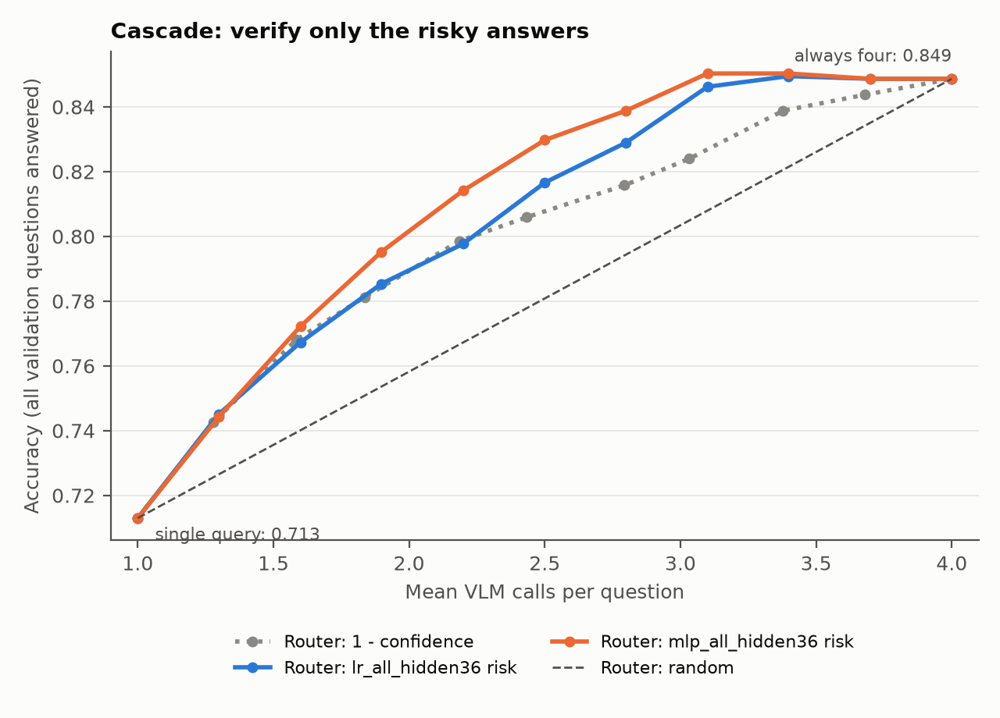

# Visual Genome results: summary for the team

Internal notes, not for submission. Generated by `scripts/11_team_summary.py` from saved
results; full tables are in `outputs/REPORT.md`.

## In short

- The VLM gets 70.7% of spatial Yes/No questions right on the test split.
- A small MLP on the last hidden layer (layer 36) detects its wrong answers better than its
  own confidence does (test AUROC 0.753 against 0.680).
- Detecting errors only lets us withhold answers. Asking the same fact four ways and averaging
  (aggregation) actually corrects them: 71.3% to 84.9% on validation.
- The best use of the MLP is as a router: verify only the answers it flags. That reaches the
  full aggregation accuracy with about 3.1 VLM calls per question in place of 4.
- Feeding the MLP's error probability into the aggregation itself did not clearly help.

## What was run

- Same frozen VLM set-up as the VSR run (Qwen2.5-VL-3B, 4-bit, same prompt).
- Visual Genome, eight spatial predicates, 2,000 relationships. Each relationship becomes four
  statements: the original, its converse (both true), and a swapped and an opposite version
  (both false). That gives 8,000 Yes/No questions, split by image into train, validation and test.
- Detectors are trained to predict "the VLM's answer is wrong" from either the confidence or
  one hidden layer.

## Part 1. Can we detect wrong answers? (test split, the main result)

AUROC with 95% interval. 0.5 is guessing.

| Detector input | Logistic regression | MLP |
|---|---|---|
| Confidence only, nothing trained | 0.680 (0.645 to 0.712) |  |
| Confidence `[p_yes, confidence]` | 0.683 (0.648 to 0.713) | 0.685 (0.651 to 0.716) |
| Hidden layer 9 | 0.582 (0.542 to 0.622) | 0.549 (0.507 to 0.592) |
| Hidden layer 18 | 0.614 (0.574 to 0.652) | 0.585 (0.543 to 0.627) |
| Hidden layer 36 | 0.732 (0.697 to 0.764) | 0.753 (0.717 to 0.786) |

- Layer 36 beats confidence: the MLP is ahead by +0.067
  (+0.039 to +0.099).
- Layers 9 and 18 are worse than confidence.
- These are on Visual Genome. The VSR numbers are on a different dataset, so the two sets of
  AUROCs should not be compared directly.

## Part 2. What can we do with the signal? (validation split, exploratory)

Everything from here on was added after the test evaluation, so it uses validation only
(1216 questions, 304 relationships). Treat it as exploratory.

| Approach | VLM calls per question | Accuracy, answering everything | Withholding about 20% | Withholding about 40% |
|---|---|---|---|---|
| Single query (baseline) | 1 | 71.3% | n/a | n/a |
| 1. Abstain, using confidence | 1 | 71.3% | 77.4% (answers 77.5%) | 79.3% (answers 54.4%) |
| 1. Abstain, using the layer-36 MLP | 1 | 71.3% | 77.1% (answers 79.9%) | 83.8% (answers 60.0%) |
| 2. Aggregate the four variants | 4 | 84.9% | n/a | n/a |
| 3. Aggregate, then abstain on a small margin | 4 | 84.9% | 89.3% (answers 79.9%) | 92.3% (answers 59.9%) |

- Aggregation gains +13.6 points (+10.3 to +16.7 points).
- Why it works: the VLM is inconsistent. It gets all four versions of a fact right for only
  31.2% of relationships.
- Hallucination in the strict sense ("Yes" to a false statement) falls from
  27.5% to 15.1% with aggregation.

## Part 3. Cascade: verify only the risky answers

Every question gets one call. A router picks the riskiest share; those get three more calls and
the aggregated answer.

| Mean VLM calls | Share verified | Random router | Confidence router | Layer-36 MLP router | MLP router, then withhold to 80% coverage |
|---|---|---|---|---|---|
| 1.0 | 0.0% | 71.3% | 71.3% | 71.3% | n/a |
| 1.6 | 20.0% | 74.0% | 76.8% | 77.2% | n/a |
| 2.2 | 40.0% | 76.7% | 79.9% | 81.4% | 83.8% |
| 2.5 | 50.0% | 78.1% | 80.6% | 83.0% | 86.2% |
| 3.1 | 70.0% | 80.8% | 82.4% | 85.0% | 89.5% |
| 4.0 | 100.0% | 84.9% | 84.9% | 84.9% | 89.3% |

- With half the questions verified (2.5 calls), the MLP router gives 83.0%;
  picking at random gives 78.1%
  (the MLP's gain over random is +3.3 to +6.4 points).
- At 3.1 calls the MLP router has sent 93.4% of the wrong
  single answers for verification and matches always-verify (85.0% against 84.9%).

## Part 4. Does using the MLP inside the aggregation help?

Here the aggregation of the four calls also uses the MLP's error probability for each call.

- Trust weighting: each call's confidence counts in proportion to how much the MLP trusts it.
- Detector votes: each call's Yes/No answer counts as much as the MLP trusts it; confidence is dropped.
- Both: the average of the two.

| Aggregation rule | Accuracy | Change against confidence only (95% interval) | Yes to a false statement | Withholding about 20% | Cascade at 2.5 calls |
|---|---|---|---|---|---|
| Confidence only (mean support) | 84.9% | baseline | 15.1% | 89.3% | 83.0% |
| Confidence, weighted by detector trust | 85.5% | +0.7 (-1.0 to +2.3 points) | 14.5% | 90.9% | 83.5% |
| Detector votes only | 81.6% | -3.3 (-7.7 to +1.0 points) | 18.4% | 89.7% | 79.9% |
| Confidence and detector votes | 85.2% | +0.3 (-2.3 to +2.7 points) | 14.8% | 90.9% | 82.8% |

- No rule is clearly better than plain confidence averaging: every interval includes zero.
  Trust weighting is +0.7 points, which is within noise.
- Dropping confidence and using only the MLP's votes is the weakest rule.
- These are four fixed rules; picking the best one from this table would be tuning on validation.

## Trade-offs

| Option | Cost | What you get | Main drawback |
|---|---|---|---|
| Single query + MLP | 1 call | Flags likely errors; can withhold them | Cannot fix an answer |
| Cascade with MLP router | about 2.5 to 3 calls | Most or all of the aggregation gain | Needs hidden states and a trained detector |
| Always aggregate | 4 calls | Highest accuracy, no detector needed | Most expensive |

## Caveats

- Parts 2 to 4 are validation-only and were not in the original plan. The MLP was also chosen
  on validation, so its numbers there are slightly optimistic.
- Aggregation needs the question rewritten as a converse, swap and opposite. Here those come
  from an annotated true relationship, so each group of four is balanced by construction.
- Truth labels come from Visual Genome annotations without a geometry check, so some "errors"
  are label noise.
- One model, one prompt, one dataset.

## Files

- `outputs/REPORT.md`: all tables, including breakdowns by predicate and variant.
- `outputs/results.json`: test results, same metric names as the VSR run.
- `outputs/aggregation.json`: everything in parts 2 to 4.
- `ASSUMPTIONS.md`: every decision and why.
